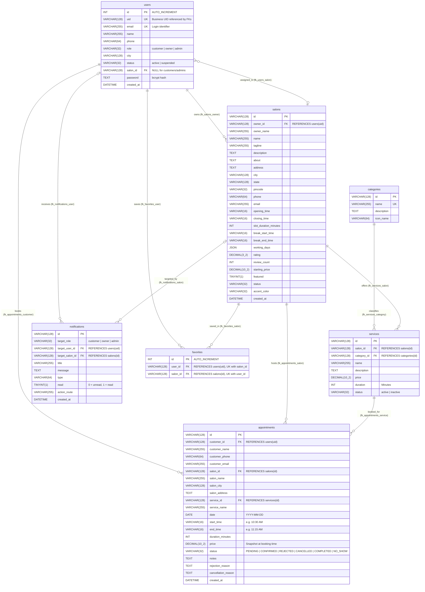

# SALONIX — Relational Database ER Diagram (`salonix_db`)

This Entity-Relationship Diagram documents the exact MySQL/MariaDB (`InnoDB`, `utf8mb4_unicode_ci`) schema used by **SALONIX** in XAMPP / phpMyAdmin (`database/salonix_mysql.sql`).

## Mermaid ER Diagram

## Foreign Key & Cardinality Reference (All 11 InnoDB Constraints)

| # | Constraint Name | Child Table & Column | Parent Table & Column | Cardinality | On Delete | On Update | Business Meaning |
|---|---|---|---|---|---|---|---|
| 1 | `fk_salons_owner` | `salons.owner_id` | `users.uid` | 1:N (Owner → Salon) | `RESTRICT` | `CASCADE` | Prevents deleting an owner account that still owns a salon. |
| 2 | `fk_users_salon` | `users.salon_id` | `salons.id` | 0..1:1 (Salon → Owner User) | `SET NULL` | `CASCADE` | Links a salon owner's account to their primary salon (`NULL` for customers & admins). |
| 3 | `fk_services_salon` | `services.salon_id` | `salons.id` | 1:N (Salon → Services) | `CASCADE` | `CASCADE` | Every service belongs to one salon. |
| 4 | `fk_services_category` | `services.category_id` | `categories.id` | 1:N (Category → Services) | `RESTRICT` | `CASCADE` | Prevents removing a category still used by salon services. |
| 5 | `fk_appointments_customer` | `appointments.customer_id` | `users.uid` | 1:N (Customer → Appointments) | `RESTRICT` | `CASCADE` | Preserves customer booking audit history. |
| 6 | `fk_appointments_salon` | `appointments.salon_id` | `salons.id` | 1:N (Salon → Appointments) | `RESTRICT` | `CASCADE` | Preserves salon booking audit history. |
| 7 | `fk_appointments_service` | `appointments.service_id` | `services.id` | 1:N (Service → Appointments) | `RESTRICT` | `CASCADE` | Prevents deleting a service that already has booked appointments (API also returns HTTP 409). |
| 8 | `fk_notifications_user` | `notifications.target_user_id` | `users.uid` | 1:N (User → Notifications) | `CASCADE` | `CASCADE` | Routes booking status alerts to the target user. |
| 9 | `fk_notifications_salon` | `notifications.target_salon_id` | `salons.id` | 1:N (Salon → Notifications) | `CASCADE` | `CASCADE` | Routes new booking requests to the target salon's owner. |
| 10 | `fk_favorites_user` | `favorites.user_id` | `users.uid` | M:N Bridge (via `favorites`) | `CASCADE` | `CASCADE` | Customer's bookmarked salons (`UNIQUE(user_id, salon_id)` prevents duplicates). |
| 11 | `fk_favorites_salon` | `favorites.salon_id` | `salons.id` | M:N Bridge (via `favorites`) | `CASCADE` | `CASCADE` | Links bookmarked salon record. |

## Viewing This Diagram Live in phpMyAdmin

1. Open **http://localhost/phpmyadmin** in your browser.
2. Click **`salonix_db`** in the left sidebar.
3. Click the **More → Designer** tab in the top navigation bar.
4. phpMyAdmin will automatically draw all 7 tables and all 11 InnoDB foreign-key relationship lines directly from `salonix_db` for your live college demonstration.
